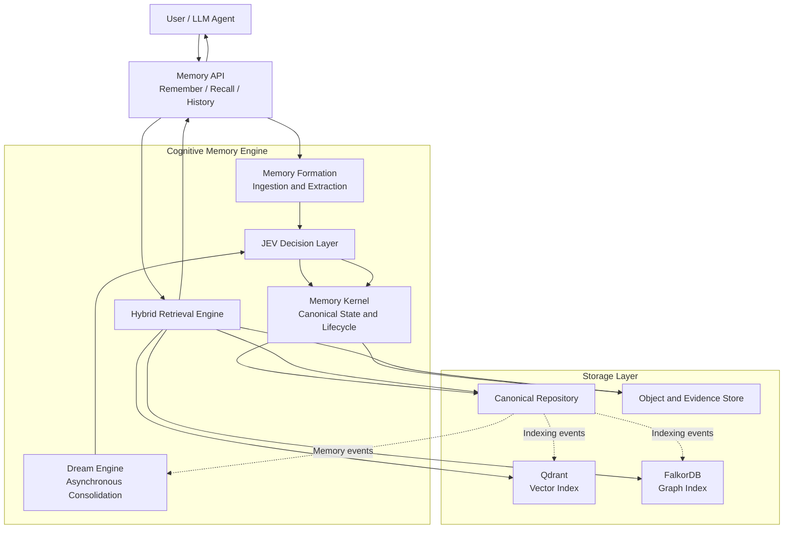
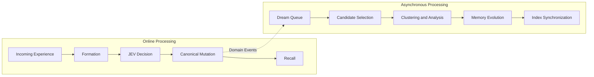
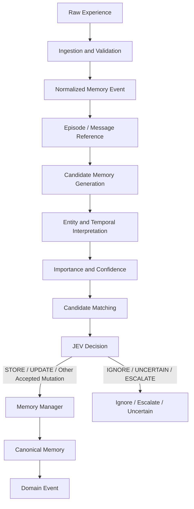
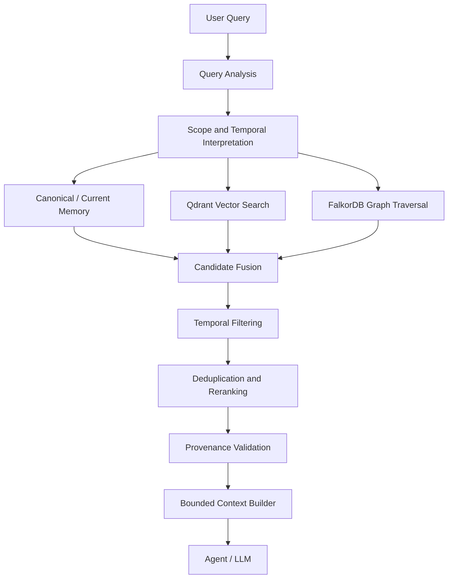
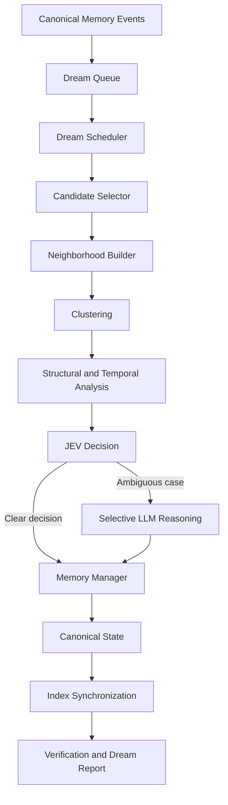
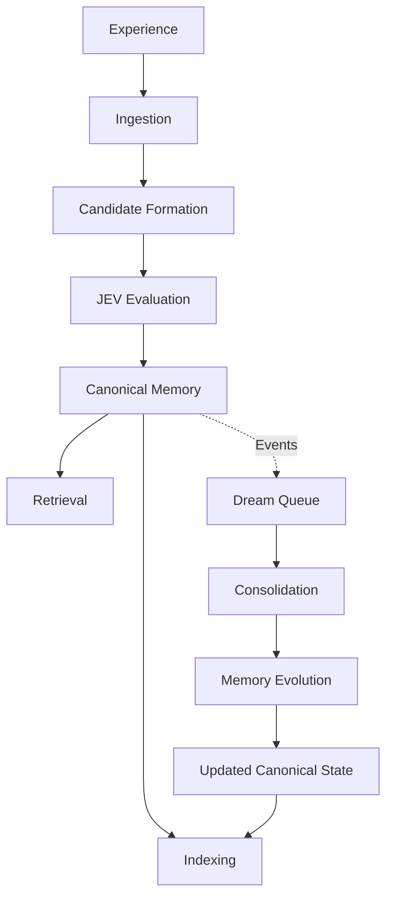

# Cognitive Memory for LLM Agents

### A Cognitive Memory System for Persistent, Context-Aware, and Evolving LLM Agents

Cognitive Memory for LLM Agents is a modular memory infrastructure designed to help AI agents retain experiences, organize knowledge, retrieve relevant context, and evolve their memories over time.

Instead of treating every interaction as an isolated conversation or relying exclusively on traditional Retrieval-Augmented Generation (RAG), this project explores a structured memory architecture that combines canonical memory management, evidence and provenance, vector similarity search, graph relationships, temporal reasoning, and asynchronous memory consolidation.

A central component of the system is the **Dream Engine**, which periodically analyzes accumulated experiences to identify redundant memories, resolve supported inconsistencies, discover relationships, reinforce useful knowledge, and manage outdated information.

The objective is to build a memory system that can serve as a reusable infrastructure layer for LLM agents, independent of a particular agent framework or language model.

> **Project status:** Phase 1 initial implementation completed with 17 passing tests. Subsequent phases are under development.

---

## Table of Contents

- [1. Motivation](#1-motivation)
- [2. Problem Statement](#2-problem-statement)
- [3. Project Objectives](#3-project-objectives)
- [4. System Architecture](#4-system-architecture)
- [5. Core Components](#5-core-components)
- [6. Memory Formation Pipeline](#6-memory-formation-pipeline)
- [7. Canonical Memory Model](#7-canonical-memory-model)
- [8. Hybrid Retrieval Architecture](#8-hybrid-retrieval-architecture)
- [9. Dream Engine and Memory Evolution](#9-dream-engine-and-memory-evolution)
- [10. Memory Lifecycle](#10-memory-lifecycle)
- [11. Five-Phase Implementation Roadmap](#11-five-phase-implementation-roadmap)
- [12. Technology Stack](#12-technology-stack)
- [13. Project Structure](#13-project-structure)
- [14. Installation and Development](#14-installation-and-development)
- [15. Testing Strategy](#15-testing-strategy)
- [16. Evaluation and Research Direction](#16-evaluation-and-research-direction)
- [17. Current Status and Limitations](#17-current-status-and-limitations)
- [18. Future Work](#18-future-work)

---

## 1. Motivation

LLM-based agents can reason about complex tasks, use tools, and interact with external systems. However, maintaining useful knowledge across interactions remains a significant engineering challenge.

A memory system for an agent must do more than store previous messages. It must determine what is worth remembering, preserve the evidence supporting a memory, retrieve information relevant to the current task, understand temporal changes, and avoid accumulating contradictory or redundant information indefinitely.

Traditional conversation histories can become expensive and difficult to search. Vector-based retrieval can find semantically similar information but does not independently establish whether two memories represent the same fact, a historical change, or a genuine contradiction.

This project explores a more structured approach in which memory is treated as a continuously managed information system rather than a passive collection of text chunks.

The architecture separates:

- Memory formation from canonical memory management.
- Canonical memory state from its storage indexes.
- Semantic similarity from memory reconciliation.
- Online memory processing from asynchronous consolidation.
- Memory retrieval from the construction of context for an LLM.
- Agent integration from the underlying memory infrastructure.

The intended result is a reusable foundation for agents that need persistent, explainable, and temporally aware memory.

---

## 2. Problem Statement

A useful cognitive memory system must address several interconnected problems.

### 2.1 Persistent Memory

Agents need to retain relevant information across conversations and sessions rather than depending exclusively on the current context window.

### 2.2 Memory Formation

Not every message deserves permanent storage. The system needs a controlled process for transforming raw experiences into structured candidate memories.

### 2.3 Redundancy

Repeated conversations may introduce the same information in slightly different forms. Without consolidation, the memory store can grow unnecessarily and retrieve duplicate information.

### 2.4 Conflicting Information

A new statement may contradict an existing memory, correct an earlier fact, or simply describe a later state.

For example:

- Earlier: A project uses SQLite.
- Later: The project has migrated to PostgreSQL.

The newer statement may represent a state transition rather than a contradiction. The system must consider temporal information and evidence before deciding how to reconcile the memories.

### 2.5 Relationship-Aware Retrieval

A relevant answer may depend on connections between multiple memories, entities, projects, or events. Similarity search alone may not recover the entire relevant context.

### 2.6 Memory Evolution

Memories have different lifetimes and levels of importance. Stable preferences, temporary goals, outdated project details, and uncertain inferences should not necessarily receive identical retention and retrieval treatment.

### 2.7 Provenance and Explainability

The system should preserve where information originated, which evidence supports it, and why a memory was created or changed.

### 2.8 Controlled Computational Cost

Continuous, unrestricted LLM-based analysis of every stored memory can become expensive. Memory consolidation should prioritize useful candidates and reserve expensive reasoning for cases that need it.

---

## 3. Project Objectives

The project aims to implement the following capabilities.

1. **Persistent canonical memory:** Maintain a controlled representation of the agent's knowledge.
2. **Structured memory formation:** Transform experiences into candidate memories through a defined pipeline.
3. **Evidence preservation:** Maintain source references and provenance for accepted memories.
4. **Decision-driven updates:** Evaluate whether information should be stored, ignored, updated, merged, superseded, or escalated for further reasoning.
5. **Hybrid retrieval:** Combine vector similarity, graph relationships, temporal filtering, and context construction.
6. **Asynchronous consolidation:** Process accumulated memory events through the Dream Engine.
7. **Memory evolution:** Support reinforcement, merging, supersession, decay, archival, and relationship discovery.
8. **Agent-agnostic integration:** Expose memory operations through a stable API and high-level tools.
9. **Recoverability:** Make derived indexes rebuildable from canonical data and preserved evidence.
10. **Measurable evaluation:** Compare retrieval quality, memory quality, latency, and computational cost using reproducible experiments.

These objectives describe the intended system. Each capability will be marked as implemented only after the corresponding code and verification are complete.

---

## 4. System Architecture

The system is designed as a modular monolith. Its logical components are separated into packages, while deployment initially remains simple.

### 4.1 High-Level Architecture



**Architectural principle:** The canonical Memory Kernel is the semantic source of truth. Qdrant and FalkorDB provide derived representations used for retrieval and relationship exploration.

The object store preserves source material and other raw evidence. The precise persistence and event-delivery mechanisms will be implemented in the storage and deployment phases.

### 4.2 Online and Offline Processing

The system separates latency-sensitive operations from background consolidation.



Online processing handles immediate memory operations. The Dream Engine processes accumulated work asynchronously, subject to execution and reasoning budgets.

---

## 5. Core Components

### 5.1 Memory Kernel

The Memory Kernel defines canonical memory state and controls mutations.

Responsibilities include:

- Stable identifiers.
- Canonical domain models.
- Memory lifecycle.
- Versioning and concurrency checks.
- Evidence references and provenance.
- Domain events.
- Controlled creation and modification of memories.

The kernel must remain independent of any particular graph or vector database.

### 5.2 Memory Formation

The formation subsystem transforms raw experiences into structured candidates.

Responsibilities include:

- Input validation and normalization.
- Event creation.
- Candidate memory generation.
- Entity resolution.
- Temporal interpretation.
- Importance and confidence estimation.
- Candidate matching.
- Decision preparation.

### 5.3 JEV Decision Layer

JEV is the decision component responsible for evaluating candidate memories and recommending appropriate actions.

Its intended decisions include:

- `STORE`
- `IGNORE`
- `UPDATE`
- `MERGE`
- `SUPERSEDE`
- `REINFORCE`
- `CONFLICT`
- `CREATE_RELATION`
- `UNCERTAIN`
- `ESCALATE`

The exact decision vocabulary may evolve as implementation progresses.

JEV must not directly mutate canonical state. The Memory Manager validates and applies accepted mutations.

Similarity is used to generate candidates for comparison; it is not, by itself, proof that two memories are equivalent.

### 5.4 Canonical Repository

The repository persists canonical memory records and supports reliable retrieval, version checks, and lifecycle operations.

It must preserve accepted memory changes even when downstream indexing systems are unavailable.

### 5.5 Object and Evidence Store

The object store preserves raw experiences and supporting evidence, such as:

- Conversation episodes.
- Individual messages.
- Source excerpts.
- Evidence records.
- Snapshots and manifests.

An evidence registry resolves evidence identifiers to the corresponding source records.

### 5.6 Vector Store — Qdrant

Qdrant is intended to provide semantic similarity search.

Its points will reference stable memory IDs and contain searchable metadata. Canonical memory records will remain under the control of the Memory Kernel.

### 5.7 Graph Store — FalkorDB

FalkorDB is the graph database selected for this project.

It will represent relationships between memories and entities, enabling bounded graph traversal and relationship-aware retrieval.

The graph is a derived representation, not an independent authority for canonical memory state.

### 5.8 Retrieval Engine

The retrieval engine combines relevant information from canonical memory, vector search, graph traversal, and temporal reasoning.

It constructs a bounded, provenance-preserving context for the agent.

### 5.9 Dream Engine

The Dream Engine consolidates accumulated experiences and evolves memory over time.

It is a core subsystem of this project, not an optional extension.

### 5.10 Agent Integration

The API and high-level tools provide controlled access to memory operations without requiring agents to interact directly with storage databases.

---

## 6. Memory Formation Pipeline

Memory formation converts experiences into candidate memories and routes them through the decision layer.



### 6.1 Experience Ingestion

Incoming content is validated, normalized, and assigned an event identifier.

The original source should remain available for provenance and later inspection.

### 6.2 Candidate Generation

The system identifies information that may be useful to retain.

A candidate contains proposed content, a memory type, importance and confidence estimates, scope, and a reference to its originating experience.

### 6.3 Candidate Matching

The system searches for potentially related memories.

Candidate generation may use:

- Exact normalized text.
- Semantic similarity.
- Shared entities.
- Project or scope overlap.
- Temporal proximity.
- Existing graph relationships.

Matching identifies candidates for evaluation; it does not determine the final semantic decision.

### 6.4 Decision and Mutation

JEV recommends an action. The Memory Manager validates and applies accepted changes.

Every accepted memory must retain its evidence references and relevant version history.

### 6.5 Event Publication

Successful canonical mutations generate domain events.

These events will eventually support asynchronous index synchronization, observability, and Dream Engine scheduling.

---

## 7. Canonical Memory Model

The Memory Kernel defines the canonical representation of memory.

### 7.1 Memory Types

The initial conceptual categories are:

| Type | Description |
|---|---|
| Episodic | Specific events and experiences |
| Semantic | Facts, concepts, and general knowledge |
| Procedural | Procedures, instructions, and learned workflows |
| Preference | Stable or evolving preferences |
| Temporal | Time-sensitive facts and state transitions |

These categories describe the intended domain model. The implementation may refine how memories are classified.

### 7.2 Memory Attributes

A canonical memory is intended to carry information such as:

| Attribute | Purpose |
|---|---|
| `memory_id` | Stable identity |
| `content` | Canonical memory content |
| `memory_type` | Semantic category |
| `evidence_ids` | References to supporting evidence |
| `created_at` | Creation timestamp |
| `updated_at` | Most recent mutation timestamp |
| `learned_at` | When the system learned the information |
| `valid_from` | Beginning of the fact's validity, when known |
| `valid_until` | End of the fact's validity, when known |
| `status` | Lifecycle state |
| `version` | Sequential version |
| `importance` | Value of retaining or retrieving the information |
| `confidence` | Confidence in the information |
| `scope` | Context in which the memory applies |
| `entity_ids` | Related entities |
| `supersedes` | Memories replaced by this memory |
| `metadata` | Additional structured information |

The exact schema will evolve as implementation requirements become clearer.

### 7.3 Importance Versus Confidence

Importance and confidence represent different properties.

**Importance** estimates how valuable information is to retain or retrieve.

**Confidence** estimates how strongly the available evidence supports that information.

A highly important memory can still have low confidence. The system must not confuse importance with factual certainty.

### 7.4 Evidence and Provenance

Memory records should retain references to their supporting evidence.

Evidence records are intended to identify the source, timestamp, content hash, and relevant source location.

This allows memory changes to be inspected and makes later conflict analysis more explainable.

### 7.5 Lifecycle

The initial lifecycle includes:

- `ACTIVE`
- `SUPERSEDED`
- `ARCHIVED`

Superseded and archived memories are not automatically deleted. Historical information can remain useful for timeline queries and explanations.

---

## 8. Hybrid Retrieval Architecture

The retrieval subsystem is designed to combine semantic, relational, and temporal information.



### 8.1 Vector Retrieval

Vector retrieval identifies memories whose embeddings are semantically similar to the query.

It is useful for finding relevant content even when the query and memory use different wording.

### 8.2 Graph Retrieval

Graph retrieval explores relationships between memories and entities.

It is intended to support questions that require connected facts or multiple related memories.

Graph traversal must be bounded to avoid unnecessarily large result sets.

### 8.3 Temporal Retrieval

Temporal reasoning distinguishes between current information and historical information.

The intended query modes include:

- Current state.
- Historical state.
- Time range.
- Before or after a specified event.
- Timeline reconstruction.
- Unknown or unspecified temporal context.

### 8.4 Candidate Fusion

Vector and graph retrieval may return overlapping results. The system must deduplicate candidates, apply scope and temporal constraints, and rank the resulting memories.

### 8.5 Context Construction

The final context should be bounded, relevant, and provenance-preserving.

It should include the information necessary for the agent's task without indiscriminately exposing every retrieved record.

---

## 9. Dream Engine and Memory Evolution

The Dream Engine is one of the central ideas of this project.

It performs asynchronous analysis over accumulated memory events to identify opportunities for consolidation and evolution.

Rather than invoking expensive reasoning over every memory after every interaction, the intended design selects useful candidates, groups related memories, performs inexpensive analysis first, and escalates ambiguous cases.

### 9.1 Dream Engine Architecture



### 9.2 Dream Triggers

The intended scheduling mechanism may trigger dreaming when:

- Enough memory events accumulate.
- A high-importance memory requires reconciliation.
- Contradiction signals appear.
- The system has been idle for a suitable interval.
- Memory pressure exceeds a configured threshold.
- A scheduled consolidation interval arrives.
- A user or administrator explicitly requests dreaming.

### 9.3 Candidate Selection

The Dream Engine should avoid repeatedly scanning every memory without reason.

Candidate selection may use:

- Recent memory events.
- Shared entities.
- Semantic similarity.
- Graph proximity.
- Temporal proximity.
- Project and scope overlap.
- Repeated updates.
- Unresolved conflicts.
- Memory age and retrieval signals.

### 9.4 Clustering and Structural Analysis

Related memories can be grouped before more expensive pairwise comparisons.

The system can then investigate:

- Duplicate or near-duplicate memories.
- Possible contradictions.
- Temporal state transitions.
- Missing relationships.
- Memories that may need reinforcement.
- Stale information.
- Potentially useful memory splits.

Clustering and similarity are candidate-generation techniques. Neither establishes semantic equivalence by itself.

### 9.5 Memory Evolution Operations

The intended evolution operations include:

| Operation | Purpose |
|---|---|
| Store | Introduce a new canonical memory |
| Update | Revise an existing memory |
| Merge | Consolidate equivalent information |
| Supersede | Mark an earlier memory as replaced |
| Reinforce | Record additional supporting evidence |
| Create relation | Add a supported relationship |
| Decay | Reduce retrieval priority |
| Archive | Remove a memory from active retrieval while retaining history |
| Split | Separate a compound memory into more useful units |
| Conflict | Preserve and investigate incompatible information |
| Uncertain | Avoid automatic mutation when evidence is insufficient |

### 9.6 Temporal Reasoning

A newer memory is not automatically more correct than an older one.

The Dream Engine must distinguish between:

- A correction to an earlier statement.
- A change in the state of a project.
- A historical fact that remains valid for an earlier period.
- A genuine contradiction.
- An uncertain inference requiring further evidence.

Temporal reasoning should preserve relevant historical state rather than simply deleting old information.

### 9.7 Selective LLM Reasoning

The Dream Engine should use deterministic rules and inexpensive candidate analysis before invoking an LLM for ambiguous cases.

LLM outputs must use a validated structured format. The Memory Manager remains responsible for checking and applying mutations.

### 9.8 Safety and Recovery

The intended Dream Engine design includes:

- Bounded execution and reasoning budgets.
- Idempotent job and mutation identifiers.
- Optimistic version checks.
- Safe handling of interrupted jobs.
- Retry and failure tracking.
- Verification of canonical and indexed versions.
- Recoverable index synchronization.
- Dream reports containing decisions and execution statistics.

These mechanisms are design requirements; they will be implemented and verified during Phase 4.

---

## 10. Memory Lifecycle

The overall memory lifecycle connects formation, storage, retrieval, and dreaming.



A memory may evolve through multiple versions while retaining its stable identity.

For example, a memory may be created from an experience, updated when new evidence arrives, superseded when a state changes, and eventually archived.

The original evidence and relevant historical records should remain available according to the system's retention policies.

---

## 11. Five-Phase Implementation Roadmap

The project is organized into five phases. Each phase builds on the previous phase and has exactly four test files, including its compatibility tests.

### Phase 1 — Memory Kernel and Foundation

**Objective:** Establish the canonical memory domain and controlled mutation boundary.

Planned and implemented components:

- Stable typed identifiers.
- Memory, Entity, Relationship, and Evidence models.
- Lifecycle rules.
- Versioning utilities.
- Domain events.
- Memory Manager.
- Initial compatibility checks.

**Initial verification:** 17 tests passed across four test files.

The current Memory Manager is in-memory only. Durable persistence has not yet been implemented.

### Phase 2 — Memory Formation and JEV

**Objective:** Transform incoming experiences into structured candidate memories and evaluate them through a decision layer.

Planned components:

- Experience ingestion.
- Candidate memory construction.
- Entity and temporal interpretation.
- Importance and confidence estimation.
- Candidate matching.
- JEV decisions.
- Evidence-preserving canonical mutations.
- Formation compatibility checks.

### Phase 3 — Storage, Graph, Vector, and Retrieval

**Objective:** Add durable storage and provenance-preserving retrieval.

Planned components:

- Canonical repository and persistence.
- Object and evidence storage.
- Qdrant vector indexing.
- FalkorDB graph indexing.
- Index synchronization and recovery.
- Hybrid retrieval.
- Temporal filtering.
- Candidate fusion and context construction.

### Phase 4 — Dream Engine and Memory Evolution

**Objective:** Implement asynchronous consolidation and controlled memory evolution.

Planned components:

- Dream queue and jobs.
- Scheduling and candidate selection.
- Neighborhood construction.
- Clustering and structural analysis.
- Duplicate and conflict detection.
- Temporal reasoning.
- JEV-based evolution decisions.
- Selective LLM reasoning.
- Memory merging, reinforcement, supersession, decay, and archival.
- Execution budgets and recovery.
- Dream reports and verification.

**The Dream Engine is a core project requirement.**

### Phase 5 — Agent Integration, Deployment, and Evaluation

**Objective:** Make the memory system usable by agents and evaluate it systematically.

Planned components:

- Versioned memory API.
- Remember, recall, history, and graph operations.
- Dream Engine API.
- Agent integration tools.
- Authentication and scope isolation.
- Local deployment.
- Health checks and observability.
- Snapshot and recovery workflows.
- Reproducible datasets and evaluation.
- Baselines and ablation experiments.

---

## 12. Technology Stack

The intended technology stack is:

| Technology | Role |
|---|---|
| Python | Core memory engine |
| pytest | Unit, integration, and compatibility testing |
| Pydantic / dataclasses | Structured models and validation, as appropriate |
| FastAPI | Planned HTTP API |
| Qdrant | Planned vector storage and semantic search |
| FalkorDB | Planned graph storage and relationship traversal |
| Docker | Local service deployment |
| Git and GitHub | Version control and project history |

Additional embedding models, LLM providers, and observability tools will be selected according to implementation needs.

The architecture is designed to keep database access behind interfaces so that storage details do not leak throughout the Memory Kernel.

---

## 13. Project Structure

The project will grow incrementally toward the following logical organization.

```text
cognitive-memory-hackathon/
├── README.md
├── pyproject.toml
├── .gitignore
├── .env.example
├── Dockerfile
├── docker-compose.yml
│
├── docs/
│   ├── architecture.md
│   ├── phase-1-memory-kernel.md
│   ├── phase-2-formation.md
│   ├── phase-3-storage-retrieval.md
│   ├── phase-4-dream-engine.md
│   └── phase-5-agent-integration.md
│
├── src/
│   └── memory_engine/
│       ├── kernel/
│       │   ├── ids.py
│       │   ├── identity.py
│       │   ├── models.py
│       │   ├── events.py
│       │   ├── lifecycle.py
│       │   ├── versioning.py
│       │   └── manager.py
│       │
│       ├── formation/
│       ├── decision/
│       ├── storage/
│       ├── graph/
│       ├── vector/
│       ├── retrieval/
│       ├── dream/
│       └── observability/
│
├── api/
├── worker/
├── agent/
├── evaluation/
│
└── tests/
    ├── phase1/
    │   ├── test_kernel.py
    │   ├── test_lifecycle.py
    │   ├── test_memory_manager.py
    │   └── test_phase1_compatibility.py
    │
    ├── phase2/
    ├── phase3/
    ├── phase4/
    └── phase5/
```

This is the target organization, not a claim that all listed directories and files already exist.

We will create files as the relevant phase requires them rather than scaffolding the entire system prematurely.

---

## 14. Installation and Development

### Prerequisites

- Python 3.11 or later.
- Git.
- A working Python virtual environment.
- Docker for the planned database services.

The current development environment uses Python 3.14.8.

### Clone the Repository

```bash
git clone https://github.com/YOUR_USERNAME/cognitive-memory-hackathon.git

cd cognitive-memory-hackathon
```

Replace `YOUR_USERNAME` with the repository owner's GitHub username.

### Create and Activate a Virtual Environment

On macOS:

```bash
python3 -m venv .venv

source .venv/bin/activate
```

### Install the Project

```bash
python -m pip install -e .
```

### Install Development Dependencies

```bash
python -m pip install pytest
```

Additional dependencies will be added when their corresponding components are implemented.

### Run the Tests

Run the complete test suite:

```bash
python -m pytest -q
```

Run Phase 1 tests specifically:

```bash
python -m pytest tests/phase1 -v
```

---

## 15. Testing Strategy

Each implementation phase will contain exactly four test files, including compatibility tests.

The test strategy progresses from individual components to end-to-end behavior.

### Phase 1

- Canonical models and identifiers.
- Lifecycle and versioning.
- Memory Manager operations.
- Compatibility between the kernel and domain events.

### Phase 2

- Ingestion and candidate formation.
- Entity resolution and extraction.
- JEV decisions.
- Formation compatibility and provenance preservation.

### Phase 3

- Object and evidence storage.
- Graph and vector integration.
- Hybrid retrieval.
- Storage and retrieval compatibility.

### Phase 4

- Dream queue and job handling.
- Consolidation and clustering.
- Memory evolution and temporal reasoning.
- Dream Engine compatibility and canonical-state integrity.

### Phase 5

- Memory API.
- Agent integration.
- End-to-end system behavior.
- Deployment and compatibility checks.

Test results will be recorded only after the corresponding tests have actually run.

---

## 16. Evaluation and Research Direction

The system will eventually be evaluated against explicit baselines rather than relying only on qualitative demonstrations.

### 16.1 Retrieval Quality

Potential metrics include:

- Recall@K.
- Precision@K.
- Mean Reciprocal Rank (MRR).
- Normalized Discounted Cumulative Gain (nDCG).
- Temporal retrieval accuracy.
- Multi-hop retrieval accuracy.

### 16.2 Memory Quality

Potential metrics include:

- Duplicate memory rate.
- Conflict detection precision and recall.
- Evidence coverage.
- Provenance completeness.
- Memory update correctness.
- Temporal state accuracy.
- Unnecessary merge rate.

### 16.3 System Performance

Potential metrics include:

- Retrieval latency.
- Formation latency.
- Dream job duration.
- LLM calls and token consumption.
- Index synchronization latency.
- Recovery time after index failures.
- Storage growth.

### 16.4 Dream Engine Ablations

Once the full retrieval and consolidation pipeline exists, planned experiments may compare:

1. Retrieval without dreaming.
2. Vector-only retrieval.
3. Vector plus graph retrieval.
4. Vector, graph, and temporal retrieval.
5. The full system with Dream Engine consolidation.

Experiments should use documented datasets, baselines, and reproducible configurations.

**No benchmark result will be claimed until it has been measured.**

---

## 17. Current Status and Limitations

### Completed Initial Work

**Phase 1 — Memory Kernel**

The initial foundation has been implemented with:

- Stable typed identifiers.
- Canonical Memory, Entity, Relationship, and Evidence models.
- Lifecycle rules.
- Versioning utilities.
- Domain events.
- An in-memory Memory Manager.
- Four Phase 1 test files.

**Verified result:** 17 tests passed in the initial Phase 1 test run.

### Remaining Work

The following components are planned but not yet implemented in the current codebase:

- Complete formation pipeline.
- Full JEV decision and reconciliation logic.
- Durable canonical persistence.
- Object and evidence storage.
- Qdrant integration.
- FalkorDB graph integration.
- Hybrid retrieval.
- Dream queue and scheduler.
- Dream Engine consolidation and memory evolution.
- Versioned API and agent integration.
- Deployment automation.
- Reproducible evaluation benchmarks.

### Current Limitations

The initial Memory Manager stores state in process memory. Its contents do not survive a process restart.

The initial foundation does not yet provide durable event publication, database transactions, distributed concurrency control, or recoverable index synchronization.

These capabilities will be introduced and tested as the relevant phases are implemented.

---

## 18. Future Work

The longer-term direction is to evolve the system into a reusable cognitive memory layer for autonomous and conversational agents.

Potential future extensions include:

- More advanced entity resolution.
- Improved temporal and causal reasoning.
- Graph-aware memory consolidation.
- Adaptive Dream Engine scheduling.
- Better evidence-based conflict resolution.
- Memory quality monitoring.
- Scope-aware multi-agent memory.
- Agent framework adapters.
- Retrieval and consolidation research.
- Memory visualization and inspection tools.

The priority is to establish a correct and testable core before introducing additional complexity.

---

## Development Philosophy

The project follows several architectural principles:

1. **Canonical state comes first.** Derived indexes must not become competing sources of truth.
2. **Evidence must survive memory evolution.** Consolidation should not erase the origin of accepted knowledge.
3. **Similarity is not semantic proof.** Candidate matching must be followed by appropriate reasoning.
4. **Temporal change is not always contradiction.** Historical state must be preserved when it remains meaningful.
5. **The Dream Engine is a core component.** It is responsible for asynchronous consolidation and controlled memory evolution.
6. **LLM reasoning should be selective.** Expensive reasoning is reserved for cases that need it.
7. **Every phase must be verified.** Implementation claims and benchmark results must match actual evidence.
8. **Build incrementally.** Each phase should integrate with the previous phases without prematurely introducing unnecessary complexity.

The ultimate goal is to build a memory system that does not merely retrieve stored text, but continuously organizes, contextualizes, and evolves the information available to an LLM agent.